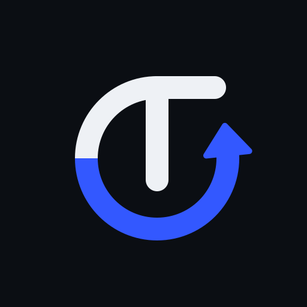

  

<h1 align="center">Tabula</h1>

<b>Aboneliklerini tek yerde gör.</b> Unutulan denemeleri, sessiz zamları ve kullanmadığın abonelikleri yakala.

<a href="https://tabula-tr.vercel.app"><b>Canlı uygulama → tabula-tr.vercel.app</b></a>

---

Tabula; Netflix'ten ChatGPT'ye, Spotify'dan iCloud'a kadar bütün aboneliklerini takip eden, telefona uygulama gibi eklenebilen bir web uygulaması (PWA). Tasarımı bir havalimanı kalkış panosundan esinleniyor: her aboneliğin bir kodu (NTFL, CLDP), bir geri sayımı (T-26 GÜN) ve canlı bir kur şeridi var.

> Bu depo projenin vitrini. Kaynak kod şimdilik gizli bir depoda tutuluyor.

## Neler yapabiliyor

- **Tek bakışta toplam:** bu ay ne ödeyeceğin, günlere göre ödeme grafiği, sıradaki çekim ve bütçe durumu
- **"Kullandın mı?"** ayda bir iki dokunuşla sorulur; her aboneliğin **kullanım başına maliyetini** hesaplar
- **Akıllı öneriler:** kullanılmayanlar, aynı işi gören abonelikler, sert zamlar ve paylaşılabilen servisler; hepsi kullanıcının kendi verisinden, tahmin yok
- **Döviz desteği:** dolar ve euro ile ödenen abonelikler güncel kurla TL'ye çevrilir, kurlar 6 saatte bir güncellenir
- **Zam takibi:** fiyat değişince geçmiş otomatik kaydedilir
- **Takvim:** ödeme ve deneme bitiş günleri
- **E-posta hatırlatmaları:** ödemeden ve deneme bitiminden önce
- **80+ hazır servis**, 8 tema, Excel/CSV dışa aktarma, Instagram hikâyesi boyutunda yıllık özet kartı
- **Ücretsiz / Pro** plan ayrımı, yönetici paneli ve uygulama içi geri bildirim

## Teknoloji

| Katman | Kullanılan |
|---|---|
| Arayüz | React 19, TypeScript, Vite, PWA (service worker, ana ekrana ekleme) |
| Sunucu | Supabase: Postgres, satır düzeyi güvenlik (RLS), tetikleyiciler, `pg_cron` zamanlanmış görevler |
| E-posta | Resend |
| Döviz kurları | Frankfurter API |
| Yayın | Vercel |

Öne çıkan mühendislik kararları:
- **Güvenlik sunucuda:** her kullanıcı yalnızca kendi verisine erişebilir; Pro ve abonelik sınırı gibi kurallar istemcide değil veritabanı tetikleyicilerinde uygulanıyor.
- **Sunucusuz zamanlanmış işler:** kur güncelleme ve hatırlatma e-postaları ayrı bir sunucu olmadan doğrudan veritabanında `pg_cron` ile çalışıyor.
- **Gizli anahtarlar kodda değil**, Supabase Vault'ta.

---

**English:** Tabula is a subscription tracker PWA built with React, TypeScript and Supabase. It tracks recurring payments in multiple currencies, calculates cost per use, flags unused subscriptions and price hikes, and sends email reminders. Source code is private; try the [live app](https://tabula-tr.vercel.app).

Geliştiren: [Ömer Taha Fidan](https://github.com/dvlp-omer)
